# Dapr actor calls overlap when the caller cancels them

Reported as [dapr/dapr#10835](https://github.com/dapr/dapr/issues/10835).

When a caller cancels actor calls (through the `CancellationToken` passed to `ActorProxy.InvokeMethodAsync`) while those calls are still queued behind the actor's running turn, the Dapr sidecar dispatches them to the actor while the earlier turn is still in progress. Two or more turns then run on the same actor id at once, which breaks turn-based concurrency. It happens with actor reentrancy **off** as well as on.

Without cancellation, turns are serialised correctly.

## Versions

- Dapr runtime 1.18.7 (Kubernetes, installed with the Dapr Helm chart, single-node kind cluster)
- Dapr .NET SDK `Dapr.Actors` / `Dapr.Actors.AspNetCore` 1.18.10, .NET 10
- State store: `state.in-memory` with `actorStateStore: "true"`

## The reproduction

- **`ActorHost`** (2 replicas) hosts `SlowActor`, whose only method `Work` waits `DelayMs`. It has no state, makes no other calls, and doesn't override any actor lifecycle hooks.
  - `Work` counts the invocations in progress per actor id: in on its first line, out in its `finally`.
  - Under turn-based concurrency that count can never go above 1. When it does, the host logs `CONCURRENT TURN`, and `GET /stats` reports the number of overlapping calls and the most invocations in progress at once.
- **`Client`** is a non-actor app. `POST /blast?actor=a1&n=20&delayMs=2000&cancelAfterMs=500` sends `n` calls to one actor id at the same moment: it starts all `n` concurrently (`Task.WhenAll`) through `ActorProxy`'s non-remoting `InvokeMethodAsync`, and doesn't wait for any call to complete before sending the next. With `cancelAfterMs`, it cancels each call's `CancellationToken` that many milliseconds after sending it.
- **`run.sh`** (Kubernetes) builds both images, loads them into kind, deploys `k8s/repro.yaml` into the namespace `actor-repro`, and runs the scenarios with reentrancy off and then on. **`run-cancel.sh`** runs only the cancellation trials. The reentrancy setting is applied to both the Dapr `Configuration` (the `Actor.Reentrancy` feature) and the SDK (`ActorReentrancyConfig.Enabled`).

```bash
./run.sh --cluster <kind cluster with Dapr installed>
./run-cancel.sh --cluster <kind cluster with Dapr installed>
./timeline.sh --cluster <kind cluster with Dapr installed> > timeline.md   # the Mermaid charts below
```

### Docker Compose

`docker-compose.yml` runs the same apps without Kubernetes:

- Dapr 1.18.7 placement and scheduler
- two actor hosts and the client, each app with its own `daprd` sidecar sharing its network namespace
- the in-memory actor state store, and a Dapr `Configuration` chosen with `REENTRANCY`

```bash
./compose-run.sh                    # the run.sh scenarios, reentrancy off then on
CANCEL_TRIALS=1 ./compose-run.sh    # the run-cancel.sh trials
REENTRANCY=true docker compose up -d --build   # or bring it up and call it by hand:
curl -X POST "localhost:18200/blast?actor=a1&n=20&delayMs=2000&cancelAfterMs=500"
curl localhost:18210/stats; curl localhost:18211/stats
```

On Compose, the scenarios without cancellation were serialised exactly, in both modes. The single cancellation trial (20 calls × 2s, cancelled at 500ms) overlapped with reentrancy on: 2 calls reached the actor, 1 of them while the other was still running. With reentrancy off, only 1 call reached the actor in that trial. That's one trial per mode, so for anything conclusive, run `CANCEL_TRIALS=1`.

## Results

`run.sh` and `run-cancel.sh`, with `Work` counting its own invocations.

**Without cancellation, there's no overlap.** Every call ran on its own, and the total time was exactly calls × delay.

| Scenario | Reentrancy off | Reentrancy on |
|---|---|---|
| 20 calls × 1,000ms | 20.1s; 0 overlapping calls; at most 1 invocation in progress | 20.1s; 0; 1 |
| 100 calls × 200ms | 20.3s; 0; 1 | 20.3s; 0; 1 |

**When the client cancels the calls, invocations overlap.** In each trial the client sent 20 calls × 2,000ms to one actor at once, and cancelled every call after the time shown. Each cell lists 3 trials as (calls that reached the actor, calls started while another was in progress, most in progress at once), summed over both hosts.

| Client cancels each call at | Reentrancy off | Reentrancy on |
|---|---|---|
| 500ms | (1,0,1) (3,2,3) (4,3,4) | (1,0,1) (4,3,4) (3,2,3) |
| 1,500ms | (3,2,3) (7,6,**7**) (6,5,6) | (1,0,1) (9,8,**9**) (5,4,5) |
| 2,500ms | (3,1,2) (6,4,5) (2,0,1) | (3,1,2) (2,0,1) (2,0,1) |
| 4,000ms | (2,0,1) (5,3,4) (2,0,1) | (3,1,2) (7,5,6) (2,0,1) |

Invocations overlapped in **8 of 12** trials with reentrancy off and **7 of 12** with it on: up to **7** and **9** invocations of `Work` at once on one actor id.

An earlier version counted in `OnPreActorMethodAsync` and `OnPostActorMethodAsync` instead of inside `Work`. It gave the same picture: 7 of 12 trials in each mode, up to 6 at once.

## Timeline

`timeline.sh` records when each invocation of `Work` started and ended. Times are relative to when the client sent the calls, with reentrancy off.

```mermaid
gantt
    title No cancellation - 5 calls x 1s run one after another
    dateFormat x
    axisFormat %S.%Ls
    section Client
    all 5 calls sent concurrently at 0s :done, 0, 5035
    section Work on actor a1
    call-0 (1 in progress) :17, 1019
    call-2 (1 in progress) :1022, 2024
    call-4 (1 in progress) :2025, 3027
    call-3 (1 in progress) :3029, 4031
    call-1 (1 in progress) :4034, 5035
```



The client sent all 5 calls at the same moment (0s), concurrently, without waiting for any to complete. Each bar under `Work on actor a1` is one invocation of `Work`, from its first line to its `finally`: the sidecar dispatched them one at a time, each starting only after the previous one had finished.

```mermaid
gantt
    title Client cancels every call at 1.5s - Work invocations overlap on one actor (reentrancy off)
    dateFormat x
    axisFormat %S.%Ls
    section Client
    all 20 calls sent concurrently at 0s, cancelled at 1.5s :done, 0, 1500
    section Work on actor a1
    call-4 (1 in progress) :59, 2061
    call-16 (4 in progress) :crit, 1549, 3554
    call-15 (2 in progress) :crit, 1549, 3554
    call-18 (3 in progress) :crit, 1549, 3554
```



The client sent all 20 calls × 2s to actor `a1` at the same moment (0s), concurrently, and cancelled every one of them at 1.5s, through the `CancellationToken` passed to `ActorProxy.InvokeMethodAsync`. Red bars started while another invocation of `Work` on the same actor was still running. This chart is from attempt 5 of 5: the script retries until a trial shows at least 3 overlapping calls. Attempt 1 showed 1, and attempts 2 to 4 showed none.

The second chart shows how it happens. The three calls in red were queued behind `call-4`, as they should be, until the client cancelled them at 1.500s. **49ms after that cancellation, the sidecar dispatched all three to the actor at once (1.549s), while `call-4` was still executing, with half a second left to run.** They didn't bypass the queue when they were sent: they waited behind `call-4` until the client cancelled them, and were dispatched to the actor only after that cancellation.

## What this shows

1. Calls that the client cancelled while they were queued behind a running turn **were still dispatched to the actor**.
2. The sidecar dispatched them **about 50ms after the client cancelled them**, in the timeline, **while the earlier turn was still executing**: up to 9 invocations on one actor id at once.
3. It doesn't depend on reentrancy.
4. Without cancellation, turns are serialised correctly.

## Expected behaviour

A cancelled call is either dropped before it reaches the actor, or dispatched only once the turn in progress has finished. A turn should never start while another turn on the same actor id is running.

## Found through

[DaprMQ](https://github.com/olitomlinson/dapr-mq): a queue actor under heavy load ended up with turns overwriting each other's state, losing counts and orphaning records. Its gateway cancels actor calls after a 10s timeout, and its Consume streams cancel outstanding actor calls when a stream ends.
